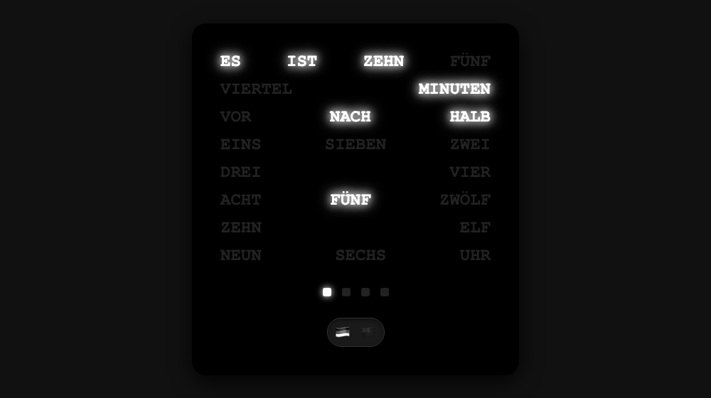

# Wortuhr · word clock

**[▶ Live demo](https://jensbri.github.io/wortuhr/)**: open it on a phone and add it to your home screen.

[](https://jensbri.github.io/wortuhr/)

A browser version of the classic German *Wortuhr*: the time is spelled out in glowing words instead of digits. The four dots count the minutes between the five-minute steps. One tap switches between German and English (NZ).

## How it was built

This was an experiment in how far an AI chat alone can take you.

- **Input:** one photo of a physical word clock
- **Tools:** an AI chat (Gemini) and a mobile browser. No laptop, IDE or local build.
- **Time:** about 20 minutes from photo to deployed site, including testing and debugging
- **Shipping:** GitHub Pages, deployed on every push

A later iteration added the English version, the language toggle and a full-screen iOS home-screen mode.

## Under the hood

- A single self-contained `index.html` (HTML, CSS and vanilla JS, no dependencies)
- Updates once a second: the time is rounded to a five-minute step and mapped to words, and the remainder lights the dots
- iOS web-app meta tags, so it runs full screen as a bedside or desk display

## Run locally

```bash
git clone https://github.com/jensbri/wortuhr.git
open wortuhr/index.html
```

## License

MIT
